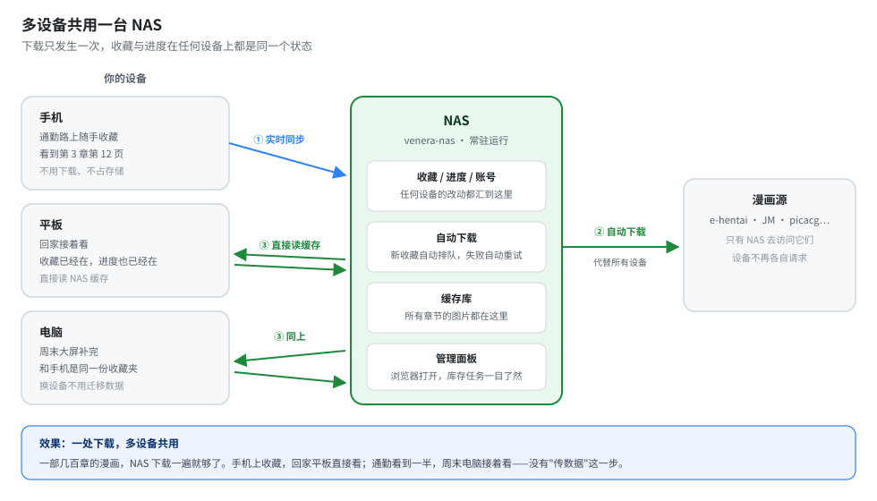
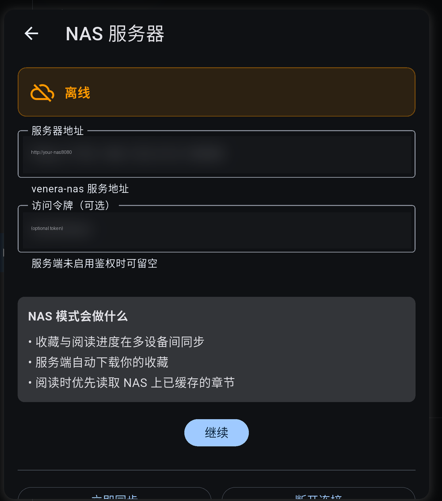
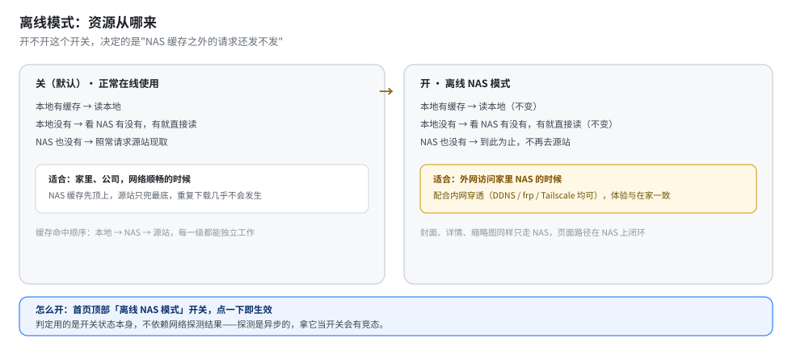
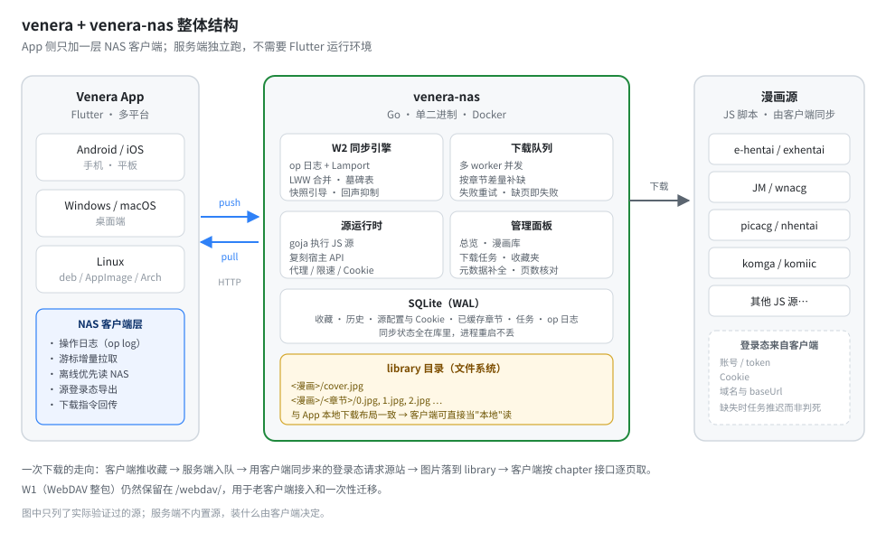
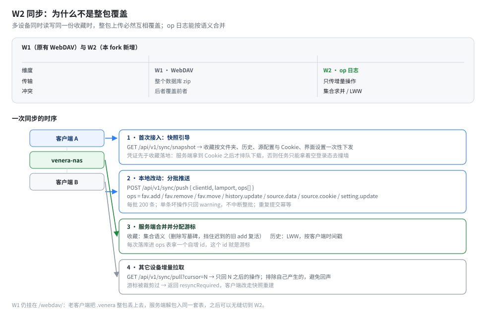

# venera（NAS 分支）

[](https://flutter.dev/)
[](https://github.com/ezsky333/venera/blob/master/LICENSE)
[](https://github.com/ezsky333/venera/releases)
[](https://github.com/ezsky333/venera/pkgs/container/venera-nas)

一个漫画阅读器。上游是 [venera-app/venera](https://github.com/venera-app/venera)（已停止维护），本分支在它之上加了一套 **NAS 服务端**：由 NAS 接管下载和缓存任务，并负责多设备之间的数据同步——NAS 自动下载你的收藏，平板和手机直接读 NAS 缓存的资源，每台设备不再各自下载一份，**一处下载，多设备共用**。

上游的功能一个没砍：JS 写漫画源、本地阅读、下载、评论、登录。

## 这能解决什么问题



没接 NAS 时，漫画数据散在每台设备上：手机收藏的和电脑收藏的是两份，换设备要手工迁移，一部大长篇在每台设备上都得下载一遍。

接上 NAS 后：

- **收藏与阅读进度实时同步**——手机上收藏的，平板打开就在；通勤看到一半，周末电脑接着看
- **NAS 自动下载**——新收藏自动排队下载，失败自动重试，手机上只管读
- **设备端零占用**——手机不装几百 GB 的漫画库，存储压力全在 NAS 上
- **源站只被 NAS 访问**——换设备、换网络都不用折腾代理

## 三步用起来

### 1. 起服务端

有 Docker 的地方就能跑（NAS、软路由、闲置电脑均可）：

```bash
mkdir -p data library
docker run -d --name venera-nas \
  -p 8080:8080 \
  -v ./data:/data \
  -v ./library:/library \
  -e VENERA_TOKEN=换成你的token \
  ghcr.io/ezsky333/venera-nas:latest
```

常用环境变量（全部可选）：

| 变量 | 说明 |
|---|---|
| `VENERA_LISTEN` | 监听地址，默认 `:8080` |
| `VENERA_DATA_DIR` / `VENERA_LIBRARY_DIR` | 元数据 / 漫画文件目录 |
| `VENERA_TOKEN` | 访问令牌，客户端填同一个值 |
| `VENERA_PROXY` | 出站代理（访问源站用） |
| `VENERA_WORKERS` / `VENERA_DOWNLOAD_CONCURRENCY` | 任务并发 / 单任务图片并发 |
| `VENERA_AUTO_DOWNLOAD_FAVORITES` | 收藏到货自动排队下载（默认开） |

### 2. 客户端连上

设置 → 應用 → NAS 伺服器，填服务端地址和 token，点繼續。首次连接会把本地的收藏、历史、源账号自动推上去，之后实时同步。



### 3. 正常用

正常搜、正常收藏、正常看。想下整本：详情页点「下载到 NAS」；想看库存和任务：浏览器开 `http://<nas>:8080/admin`。

## 离线也能看



首页顶部有一个**离线 NAS 模式**开关，两种场景用得上：

- **人在外面**：家里 NAS 通过内网穿透可达（DDNS / frp / Tailscale 均可），封面、详情、正文全部从 NAS 取，行为和在家里完全一样，手机到源站的请求为零
- **NAS 暂时连不上**：本地下载过的章节照常读；没缓存的明确提示，不转圈不报错

关掉开关则回到正常路径：本地 → NAS → 源站三级兜底，NAS 没有的章节会去源站现取。

## 管理面板

浏览器打开 `http://<nas>:8080/admin`：

| 页签 | 能做什么 |
|---|---|
| 总览 | 库容量、任务状态、待补元数据数 |
| 漫画库 | 浏览已缓存的漫画和章节，单个删除 |
| 下载任务 | 重试 / 置顶 / 删除，失败原因一目了然 |
| 收藏夹 | 按收藏夹浏览，一键补录未缓存的收藏 |

另有「补全元数据信息」按钮：把 comics 表里缺的作者、简介、标签回源补上。

## 原理（想折腾再读）

服务端是 Go 写的单二进制（Docker 镜像 amd64/arm64），comic 源还是那些 JS 脚本——服务端里用 goja 跑它们，客户端装的源会自动同步上去，登录态也一起带过去。文件落盘布局与 App 本地下载完全一致，客户端可以直接当"本地漫画"读。



### 同步协议 W2

上游的 WebDAV 同步是把数据库打成 zip 整包上传，多设备必然互相覆盖。本分支实现新协议 W2：只传增量操作，服务端按语义合并。



- **幂等**，重复推同一条收藏不会出现两条
- **收藏是集合语义**——删除写墓碑表，迟到的旧 add 复活不了它
- **历史是 LWW**，按客户端时间戳取新
- **凭证先于收藏落地**，服务端拿到 Cookie 之后才排队下载

协议细节见 [docs/03-W2同步协议规范.md](docs/03-W2同步协议规范.md)。

### 数据完整性

修了几个上游遗留的坑：

- 源站返回 0 页的章节不再被记成"已缓存"（旧数据里真有过这种记录）
- 下载中途失败的章节整个作废重下，不再留下编号空洞（真案例：一章 page_count=64 但磁盘缺 6 页，客户端按序号拼 URL 就 404）
- 附带 `maintenance/page-audit` 端点核对 page_count 与磁盘文件数

## 从源码构建

1. 装 Flutter（版本锁在 [pubspec.yaml](pubspec.yaml)）和 Rust
2. `flutter build apk`（或对应平台）
3. 服务端：`cd server && go build ./cmd/venera-nas`

## 文档

| 文档 | 内容 |
|---|---|
| [01-架构分析.md](docs/01-架构分析.md) | 上游架构、源脚本宿主 API 的实测分布、可行性判断 |
| [02-技术方案与决策.md](docs/02-技术方案与决策.md) | 为什么 Go + goja、为什么不用 Flutter headless |
| [03-W2同步协议规范.md](docs/03-W2同步协议规范.md) | op 类型、合并语义、游标、端点契约 |
| [04-部署指南.md](docs/04-部署指南.md) | Docker / compose / 卷权限 / 反代 |
| [05-改动清单.md](docs/05-改动清单.md) | 相对上游改了哪些文件、加了哪些 |

## 与上游的差异边界

- 独立包名 `xyz.ezsky.venera`，可与上游共存
- CI 全平台出包（Android / Windows / macOS / Linux / iOS），tag 推送即发布
- 上游的 WebDAV 同步保留在 `/webdav/`，老数据可以先用它迁移再切 W2

## 致谢

- [venera-app/venera](https://github.com/venera-app/venera) —— 本分支的全部基础
- [EhTagTranslation](https://github.com/EhTagTranslation/Database) —— 标签中文翻译
- 源脚本来自社区维护的 [venera-configs](https://github.com/venera-app/venera-configs)

## License

GPL-3.0，与上游一致。
