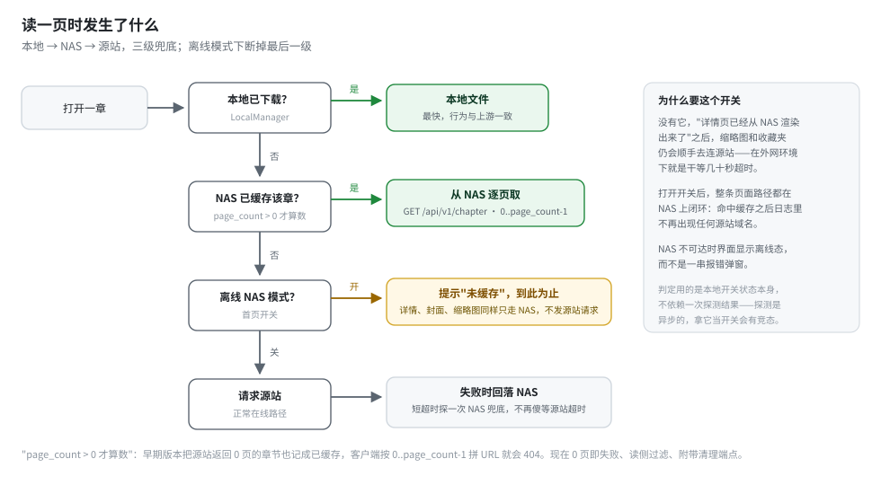

# venera（NAS 分支）

[](https://flutter.dev/)
[](https://github.com/ezsky333/venera/blob/master/LICENSE)
[](https://github.com/ezsky333/venera/releases)
[](https://github.com/ezsky333/venera/pkgs/container/venera-nas)

一个漫画阅读器，支持本地和网络源。上游是 [venera-app/venera](https://github.com/venera-app/venera)（已停止维护），本分支在它之上加了一套 **NAS 服务端**：收藏和历史在多设备间同步，服务端代替你下载，阅读时优先读 NAS 缓存。

上游的功能一个没砍：JS 写漫画源、本地阅读、下载、评论、登录。这个 README 只讲加了什么。

## 加了什么

一句话：**把"每台设备各自连源站"改成"一台 NAS 替所有设备连源站"。**

- 收藏、阅读历史、源账号（含 Cookie）、界面设置，在手机/电脑之间实时同步
- NAS 后台把你的收藏下载下来，手机上只管读
- 外网 or 服务端挂了？开离线模式，封面、详情、正文全部只走 NAS
- 浏览器开一个管理面板，看任务、看库存、补元数据

## 结构


服务端是 Go 写的单二进制（Docker 镜像 amd64/arm64）， comic 源还是那些 JS 脚本——服务端里用 goja 跑它们，客户端装的源会自动同步上去，登录态也一起带过去。文件落盘布局与 App 本地下载完全一致，客户端可以直接当"本地漫画"读。

## 同步协议（W2）

上游的 WebDAV 同步是把数据库打成 zip 整包上传，多设备必然互相覆盖。这个分支实现了新协议 W2：只传增量操作，服务端按语义合并。


要点：

- **幂等**，重复推同一条收藏不会出现两条
- **收藏是集合语义**——删除写墓碑表，迟到的旧 add 复活不了它
- **历史是 LWW**，按客户端时间戳取新
- **游标增量拉取**，排除自己产生的操作（回声抑制）；游标过期就下发快照重建
- 源登录态跟着走，服务端下载用的是你的账号；凭证先于收藏落地，否则任务只能拿着空 Cookie 去撞墙

协议细节见 [docs/03-W2同步协议规范.md](docs/03-W2同步协议规范.md)。

## 阅读路径



本地 → NAS → 源站三级兜底。**离线 NAS 模式**是首页一个开关：打开后整条页面路径都在 NAS 上闭环——详情页、封面、缩略图、正文，命中缓存之后不再发任何源站请求。这个开关的判定用的是本地状态本身，而不是一次探测结果，探测是异步的，拿它当开关有竞态。

顺带修了几个上游遗留的数据完整性问题：

- 源站返回 0 页的章节不再被记成"已缓存"（旧数据里有 3 条这种脏记录）
- 下载中途失败的章节整个作废重下，不再留下编号空洞（旧数据里有一章 page_count=64 但磁盘上缺 6 页，客户端按序号拼 URL 就 404）
- 附带 `maintenance/page-audit` 端点核对 page_count 与磁盘文件数

## 快速开始

### 1. 起服务端

```bash
mkdir -p data library
docker run -d --name venera-nas \
  -p 8080:8080 \
  -v ./data:/data \
  -v ./library:/library \
  -e VENERA_TOKEN=换成你的token \
  ghcr.io/ezsky333/venera-nas:latest
```

常用环境变量（全部可选，除端口外都有默认值）：

| 变量 | 说明 |
|---|---|
| `VENERA_LISTEN` | 监听地址，默认 `:8080` |
| `VENERA_DATA_DIR` / `VENERA_LIBRARY_DIR` | 元数据 / 漫画文件目录 |
| `VENERA_TOKEN` | 访问令牌，客户端填同一个值 |
| `VENERA_PROXY` | 出站代理（访问源站用），`VENERA_PROXY_BYPASS` 排除网段 |
| `VENERA_WORKERS` / `VENERA_DOWNLOAD_CONCURRENCY` | 任务并发 / 单任务图片并发 |
| `VENERA_GLOBAL_RPS` | 对源站的整体限速 |
| `VENERA_AUTO_DOWNLOAD_FAVORITES` | 收藏到货自动排队下载（默认开） |
| `VENERA_MAX_LIBRARY_BYTES` | 库容量上限 |

更多部署方式（compose、非 root 卷权限自愈）见 [docs/04-部署指南.md](docs/04-部署指南.md)。

### 2. 客户端连上

设置 → 應用 → NAS 伺服器，填服务端地址和 token，点繼續。首次连接会把本地的收藏、历史、源配置全量推上去，之后实时同步。


### 3. 管理面板

浏览器开 `http://<nas>:8080/admin`：总览、漫画库、下载任务（重试/置顶/删除）、收藏夹，外加两个维护按钮——「补全元数据信息」和页数核对清理。

## 从源码构建

1. 装 Flutter（版本锁在 [pubspec.yaml](pubspec.yaml)）和 Rust
2. `flutter build apk`（或对应平台）
3. 服务端：`cd server && go build ./cmd/venera-nas`

## 文档

| 文档 | 内容 |
|---|---|
| [01-架构分析.md](docs/01-架构分析.md) | 上游架构、源脚本宿主 API 的实测分布、可行性判断 |
| [02-技术方案与决策.md](docs/02-技术方案与决策.md) | 为什么 Go + goja、为什么不用 Flutter headless |
| [03-W2同步协议规范.md](docs/03-W2同步协议规范.md) | op 类型、合并语义、游标、端点契约 |
| [04-部署指南.md](docs/04-部署指南.md) | Docker / compose / 卷权限 / 反代 |
| [05-改动清单.md](docs/05-改动清单.md) | 相对上游改了哪些文件、加了哪些 |

## 与上游的差异边界

- 独立包名 `xyz.ezsky.venera`，可与上游共存
- CI 全平台出包（Android / Windows / macOS / Linux / iOS），tag 推送即发布
- 上游的 WebDAV 同步保留在 `/webdav/`，老数据可以先用它迁移再切 W2

## 致谢

- [venera-app/venera](https://github.com/venera-app/venera) —— 本分支的全部基础
- [EhTagTranslation](https://github.com/EhTagTranslation/Database) —— 标签中文翻译
- 源脚本来自社区维护的 [venera-configs](https://github.com/venera-app/venera-configs)

## License

GPL-3.0，与上游一致。
