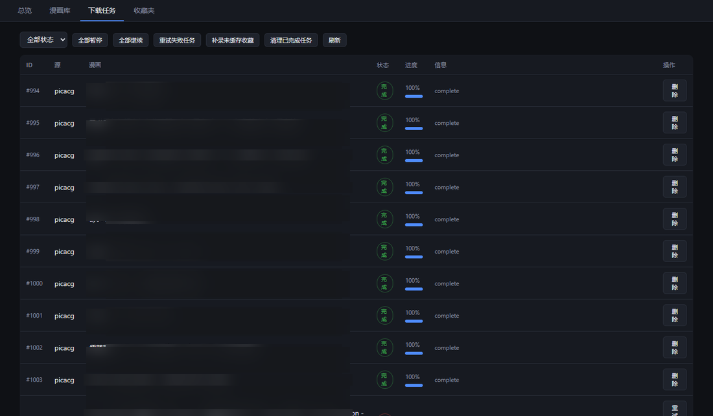
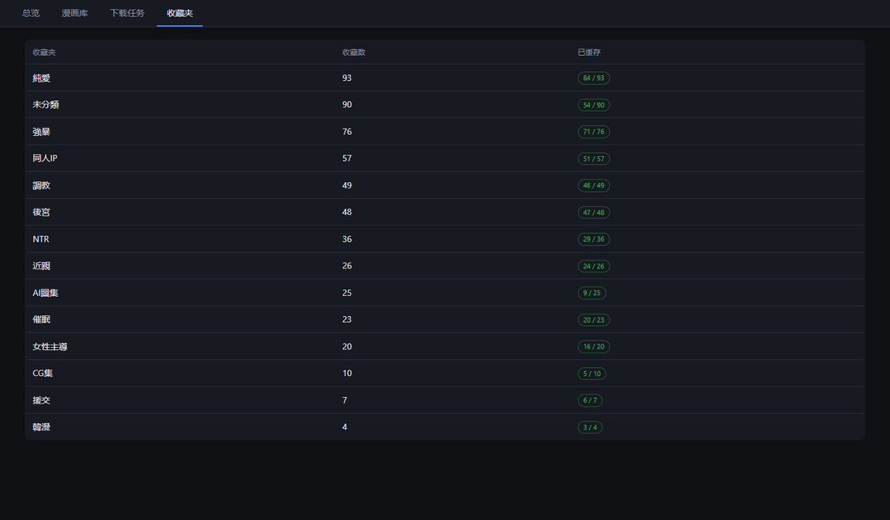

# venera（NAS 分支）

[](https://flutter.dev/)
[](https://github.com/ezsky333/venera/blob/master/LICENSE)
[](https://github.com/ezsky333/venera/releases)
[](https://github.com/ezsky333/venera/pkgs/container/venera-nas)

一个漫画阅读器，上游是 [venera-app/venera](https://github.com/venera-app/venera)。本分支在它之上加了一套 **NAS 服务端，作为缓存中台**：下载任务由 NAS 接管，收藏、阅读进度、源账号在多设备间保持同步。手机和平板不再各自下载资源，直接读 NAS 缓存——**一处下载，多设备共用**。

## 用起来是什么样


- **同步**：任何设备上收藏、看到哪一页，其他设备打开就是最新的
- **下载**：新收藏自动在 NAS 排队下载；手动想下的，详情页点「下载到 NAS」
- **阅读**：本地缓存 → NAS 缓存 → 源站，按顺序取，NAS 有的章节不用再等网络
- **省存储**：几百 GB 的漫画库放在 NAS，设备端只留一点本地缓存

## 三步上手

**1. 起服务端**（NAS、软路由、闲置电脑，有 Docker 就行）：

```bash
mkdir -p data library
docker run -d --name venera-nas \
  -p 8080:8080 \
  -v ./data:/data \
  -v ./library:/library \
  -e VENERA_TOKEN=换成你的token \
  ghcr.io/ezsky333/venera-nas:latest
```

<details>
<summary>常用环境变量（全部可选）</summary>

| 变量 | 说明 |
|---|---|
| `VENERA_LISTEN` | 监听地址，默认 `:8080` |
| `VENERA_DATA_DIR` / `VENERA_LIBRARY_DIR` | 元数据 / 漫画文件目录 |
| `VENERA_TOKEN` | 访问令牌，客户端填同一个值 |
| `VENERA_PROXY` | 出站代理（访问源站用） |
| `VENERA_WORKERS` / `VENERA_DOWNLOAD_CONCURRENCY` | 任务并发 / 单任务图片并发 |
| `VENERA_AUTO_DOWNLOAD_FAVORITES` | 收藏到货自动排队下载（默认开） |

</details>

**2. 客户端连接**：设置 → 应用 → NAS 服务器，填地址和 token，点继续。


连接成功后，客户端会做两件事：

- 把本地的**收藏夹同步**到服务端，服务端随即**自动下载**已收藏漫画的章节——你不需要手动点下载，收藏即下载
- 把阅读历史、源账号（含 Cookie）一并推上去，多设备从此共享同一份状态

下载在后台排队进行，进度随时可以在管理面板看：浏览器打开 `http://<nas>:8080/admin`。下载任务页能看到每一本的进度和状态，失败的可一键重试；收藏夹页能看到每个收藏夹已缓存了多少本。

| | |
|---|---|
|  |  |

**3. 读的时候**：NAS 缓存完成后，打开收藏里的漫画，页面直接从 NAS 取——**不再请求源站，也不占本地存储**。读起来是这样的：


## 离线模式

首页顶部的「离线 NAS 模式」开关，为一种场景准备：**你不关心收藏有没有更新，只想尽快从 NAS 取到已缓存的元数据和正文来读**。

打开后，封面、详情、阅读内页的第一次请求都先发给 NAS，源站退到最后面；关着的时候反过来，源站能用就走源站，NAS 只在失败时兜底。差别逐项是这些：


阅读内页是最严格的一处：开着离线模式时，本地没有、NAS 也没缓存，就直接告诉你「这一章没缓存在 NAS 上」，不再回源站转圈。想追更就关掉它。

## 原理（想折腾再读）

服务端是 Go 单二进制（Docker 镜像 amd64/arm64），comic 源还是那些 JS 脚本——服务端里用 goja 跑它们，客户端装的源会自动同步上去，登录态也一起带过去。文件落盘布局与 App 本地下载完全一致，客户端可以直接当"本地漫画"读。


### 同步协议 W2

上游的 WebDAV 同步是把数据库打成 zip 整包上传，多设备必然互相覆盖，服务端也没法回传任何信息。本分支实现新协议 W2：只传增量操作，服务端按语义合并，游标只往一个方向走。


- **幂等**，重复推同一条收藏不会出现两条
- **收藏是集合语义**——删除写墓碑表，迟到的旧 add 复活不了它（服务端还会回 warning，让那台设备把幽灵删掉）
- **历史是 LWW**，按客户端时间戳取新
- **凭证先于收藏落地**，服务端拿到 Cookie 之后才排队下载
- **回显抑制**，拉取时默认跳过自己产生的操作；游标被裁掉的旧设备会收到 `resyncRequired`，改走快照

协议细节见 [docs/03-W2同步协议规范.md](docs/03-W2同步协议规范.md)。

### 数据完整性

- 源站返回 0 页的章节不再被记成"已缓存"
- 下载中途失败的章节整个作废重下，不留编号空洞（真案例：一章 page_count=64 但磁盘缺 6 页，按序号拼 URL 就 404）
- `maintenance/page-audit` 端点核对 page_count 与磁盘文件数

## 从源码构建

1. 装 Flutter（版本锁在 [pubspec.yaml](pubspec.yaml)）和 Rust
2. `flutter build apk`（或对应平台）
3. 服务端：`cd server && go build ./cmd/venera-nas`

## 文档

| 文档 | 内容 |
|---|---|
| [01-架构分析.md](docs/01-架构分析.md) | 上游架构、源脚本宿主 API 的实测分布、可行性判断 |
| [02-技术方案与决策.md](docs/02-技术方案与决策.md) | 为什么 Go + goja、为什么不用 Flutter headless |
| [03-W2同步协议规范.md](docs/03-W2同步协议规范.md) | op 类型、合并语义、游标、端点契约 |
| [04-部署指南.md](docs/04-部署指南.md) | Docker / compose / 卷权限 / 反代 |
| [05-改动清单.md](docs/05-改动清单.md) | 相对上游改了哪些文件、加了哪些 |

## 与上游的差异边界

- 独立包名 `xyz.ezsky.venera`，可与上游共存
- CI 全平台出包（Android / Windows / macOS / Linux / iOS），tag 推送即发布
- 上游的 WebDAV 同步保留在 `/webdav/`，老数据可以先用它迁移再切 W2

## 致谢

- [venera-app/venera](https://github.com/venera-app/venera) —— 本分支的全部基础
- [EhTagTranslation](https://github.com/EhTagTranslation/Database) —— 标签中文翻译
- 源脚本来自社区维护的 [venera-configs](https://github.com/venera-app/venera-configs)

## License

GPL-3.0，与上游一致。
